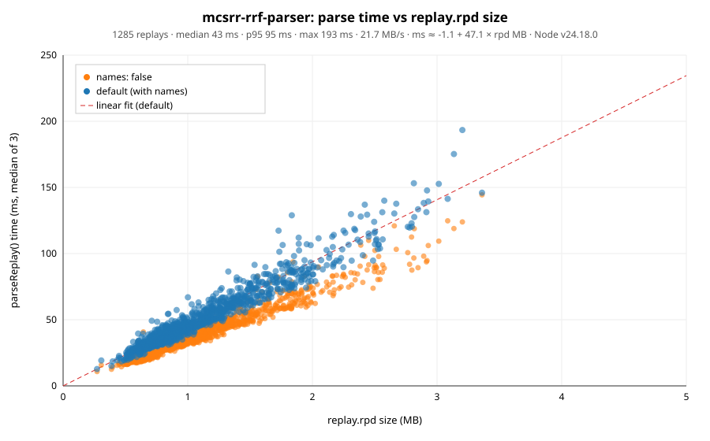
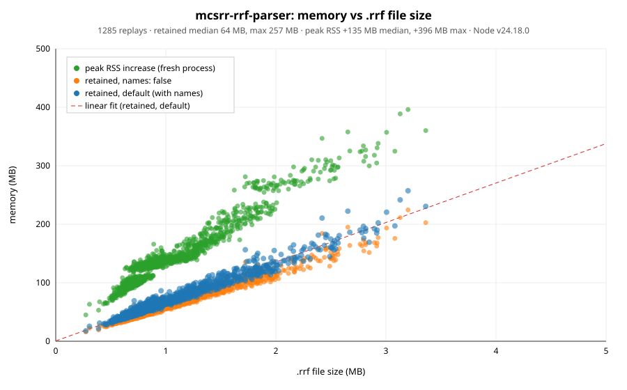

# mcsrr-rrf-parser

An offline parser for [MCSR Ranked](https://mcsrranked.com) `.rrf` replay files, with a command-line tool and a typed
TypeScript/Node.js API.

- It targets **MCSR Ranked 6.0.11** on **Minecraft 1.16.1**, and it also reads older replays back to format version 20,
  including the legacy encrypted ones.
- It runs fully offline and has no runtime dependencies. The mod data it needs is in `data/mcsrranked.json`, and the vanilla
  1.16.1 registries and block states are in `data/mc_1_16_1.json`. Both ship with the package.
- Records are decoded into typed objects, with readable names such as `zombie`, `diamond_sword` or
  `oak_stairs[facing=north,...]` added alongside the raw ids.

What each event means, when it is emitted, and its units and special values are described in
[docs/EVENTS.md](docs/EVENTS.md). You don't need the mod's source to use them. The byte-level file format is documented
in [docs/FORMAT.md](docs/FORMAT.md).

> This is an unofficial project. It is not affiliated with or endorsed by MCSR Ranked, Mojang or Microsoft.

## Requirements

You need **Node.js 22.15 or newer**. The package is ESM, but `require('mcsrr-rrf-parser')` also works.

## Install

```sh
npm install mcsrr-rrf-parser        # library
npm install -g mcsrr-rrf-parser     # CLI
```

## Command line

```sh
mcsrr-rrf match.rrf > match.json                  # full JSON on stdout
mcsrr-rrf match.rrf -o match.json                 # streamed to a file (fine for very large replays)
mcsrr-rrf match.rrf --summary                     # per-player overview
mcsrr-rrf match.rrf --player Alice --types PLAYER_POSITION,BLOCK_UPDATE
```

| Option | Description |
| --- | --- |
| `-o, --output <file>` | Write to a file instead of stdout. |
| `--summary` | Print a per-player summary instead of JSON. |
| `--player <name\|uuid>` | Only output this player. Matching ignores case and dashes. |
| `--types <A,B,...>` | Only output these record types. Canonical, wire (`*_DELTA`) and legacy names all work. |
| `--no-names` | Leave out the readable `names` field on records. |
| `-v, --version` | Print the parser, mod and Minecraft versions. |
| `-h, --help` | Show help. |

The exit codes are:

| Code | Meaning |
| --- | --- |
| `0` | Success. |
| `1` | A fatal error, such as an unreadable file or an unknown player. |
| `2` | A usage error. |
| `3` | The replay was parsed, but some chunks failed to decode. Those chunks are listed in `errors`, and everything else is still output. |

Here is an example `--summary`:

```text
version: 40
matchId: 14708736   matchType: 2   date: 2026-11-04T19:36:27.007Z
seeds: overworld=4080493132538350284 nether=268317951409269 end=4080493132538350284
result: 193c9ec7ba914756bcc8b7d1ccbf4f8b (MemePapa69) time=1961350ms
timelines: 63   decode errors: 0   warnings: 0

player FlorisMC d1b0395e-ea8e-42b8-8ba4-9508e55b7b10
  chunks: 390   records: 115810
  ticks: 0 (0.00s) .. 39123 (1956.15s)
  final position: OVERWORLD 19.500 66.000 7.500 @ tick 39106
  ...
```

## API

```ts
import { parseReplay } from 'mcsrr-rrf-parser';

const replay = parseReplay('match.rrf');          // a path, file URL, Buffer, Uint8Array or ArrayBuffer

console.log(replay.meta.matchId, replay.meta.overworldSeed);
for (const player of replay.players.values()) {
  for (const record of player.records) {
    // `type` is a discriminant: checking it narrows `data` to that record's shape.
    if (record.type === 'PLAYER_POSITION') {
      console.log(player.nickname, record.tick, record.world, record.data.x, record.data.y, record.data.z);
    } else if (record.type === 'INVENTORY_SLOT') {
      console.log(record.data.slot, record.names?.item, record.data.count);
    }
  }
}
```

### Functions

| Function | Description |
| --- | --- |
| `parseReplay(input, options?)` | Parses the whole replay synchronously and returns a `Replay`. |
| `readReplay(input, options?)` | The same, but reads the file asynchronously. Decoding is still synchronous. |
| `openReplay(input, options?)` | Reads `meta` and `timelines` without decoding any records. Its `records()` generator then yields `{ uuid, nickname, chunk, record }` one at a time, which keeps memory low. |
| `summarize(replay, { player? })` | Returns structured per-player stats: counts by type, tick range, final position and sanity notes. |
| `formatSummary(replay, { player? })` | Returns the text that `--summary` prints. |
| `toJSON(replay, { player? })` | Returns the CLI's JSON document as a string. |
| `writeJSON(replay, pathOrFd, { player? })` | Streams that JSON to a file path or an open file descriptor. |
| `registryName(registry, id)` | Looks up a vanilla 1.16.1 name, for example `registryName('item', 1) === 'stone'`. |
| `blockState(rawId)` | Looks up a 1.16.1 block state string. |

### Options

| Option | Description |
| --- | --- |
| `types` | The record types to keep. It accepts an array, a `Set` or a comma-separated string, and ignores case. Unknown names throw an error. All chunks are still decoded, because delta positions and entity names depend on earlier records. |
| `names` | Set this to `false` to skip the readable `names` field. It defaults to `true`. |
| `onRecord(player, record)` | Only available on `parseReplay` and `readReplay`. It is called for each kept record, and those records are then not stored in `player.records`. |
| `maxEntrySize` | The largest a ZIP entry may inflate to, in bytes. It defaults to 64 MiB; real replays stay under 4 MiB. Larger entries throw a `DecodeError` before anything is inflated. |
| `maxChunkSize` | The largest a `replay.rpd` chunk may decompress to, in bytes. It defaults to 16 MiB; real chunks stay under 64 KiB. Larger chunks are reported in `errors` with stage `decompress`. |
| `legacyPublicKey` | Overrides the RSA key used to decrypt pre-v40 replays. It accepts a `KeyObject`, a PEM string or base64 SPKI. You normally don't need it, because the mod's key is built in. |

### Results

A `Replay` has these fields:

| Field | Description |
| --- | --- |
| `meta` | The normalized `meta.json`. |
| `timelines` | The entries from `timelines.json`, such as nether enter and other split events. |
| `players` | A `Map` from dashed lowercase UUID to `PlayerReplay`. Players listed in meta come first. |
| `errors` | The chunks that failed to decode. |
| `warnings` | Non-fatal problems with the file. |

Use `replay.findPlayer(nicknameOrUuid)` to look up a single player.

A `PlayerReplay` has the fields `uuid`, `nickname`, `inMeta`, `chunks` and `records`.

Every record has these fields:

| Field | Description |
| --- | --- |
| `type` | The canonical record type. `*_DELTA` wire records are folded into their base type, so `PLAYER_POSITION_DELTA` is reported as `PLAYER_POSITION`. |
| `wireType` | The type actually stored in the file. |
| `tick` | Ticks since this player's recording started, at 20 per second. This is not the world time. |
| `world` | `OVERWORLD`, `NETHER`, `END` or `null`. |
| `data` | The decoded fields. Their types are in `RecordDataMap`, and their meaning is in [docs/EVENTS.md](docs/EVENTS.md). |
| `names` | The readable names for ids in `data`, when any apply. |
| `chunk` | The index of the chunk the record came from. |
| `legacy` | `true` when the record was decoded from the old format-0 layout. |

The useful types are all exported: `ReplayRecord`, `ReplayRecord<'BLOCK_UPDATE'>`, `RecordType`, `RecordDataMap`,
`ReplayMeta`, `ReplaySummary` and so on.

### Streaming

```ts
import { openReplay } from 'mcsrr-rrf-parser';

const opened = openReplay('match.rrf', { types: ['ENTITY_ADD'] });
console.log(opened.meta.players.map((p) => p.nickname), opened.chunkCount);
for (const { nickname, record } of opened.records()) {
  if (record.type === 'ENTITY_ADD') console.log(nickname, record.tick, record.names?.entityType);
}
console.log(opened.errors);   // filled while iterating
```

### Things to know

- **64-bit values are strings.** Seeds (`meta.overworldSeed` and the other seeds) and `WORLD_TIME`'s `timeOfDay` are
  Java `long`s, so they are given as decimal strings whenever they could lose precision as a JavaScript `number`.
- **"tick went backwards" notes in the summary are normal.** The mod writes some records with an older absolute tick
  after newer ones. The order matches the file, and the ticks are correct.
- **Untrusted files are safe to parse.** Decompressed sizes are capped (see `maxEntrySize` and `maxChunkSize`), so a
  crafted upload can't inflate into gigabytes. Parsing is synchronous, so run it in a worker if you parse uploads on a
  busy server.
- **Legacy encrypted replays (before v40) are decrypted automatically** with the public key built into the mod.
- **Low-level building blocks** are available from `mcsrr-rrf-parser/internals`. This includes the binary `Reader`,
  `DECODERS`, the delta tracking, the container and codec helpers, the raw mod data (`MOD_DATA`) and more. That subpath
  has no stability guarantees.

## Performance

Measured on 1,285 ranked replays played between October 30 and November 7, 2026, on an Apple M5 Max with Node.js
24.18. Each parse time is the median of 3 runs.

| | Median | p95 | Max |
| --- | --: | --: | --: |
| `.rrf` file size | 0.93 MB | 2.05 MB | 3.36 MB |
| Records | 169k | 367k | 679k |
| Parse time | 43 ms | 95 ms | 193 ms |
| Parse time, `names: false` | 33 ms | 75 ms | 144 ms |
| Memory held by the `Replay` | 64 MB | 141 MB | 257 MB |
| Memory held, `names: false` | 56 MB | 123 MB | 225 MB |
| Peak RSS increase | 135 MB | 271 MB | 396 MB |
| JSON output | 44 MB | 98 MB | 180 MB |

Both time and memory grow linearly with file size: about 47 ms per MB of `replay.rpd`, and about 67 MB held per MB
of `.rrf`. Most of that memory is the records themselves, so if you only need some of them, use `onRecord` or
`openReplay().records()` instead of keeping the whole `Replay`.





The numbers for every replay are in [bench/results.csv](bench/results.csv).

## Updating for a new mod version

The mod-specific knowledge lives in three places:

- **`data/mcsrranked.json`** holds the `TimeLineType` ids and factories, which delta types fold into which canonical
  types, the legacy ids, the mod enums, the pie-chart names, the replay public key and the mod version. It also records
  the `ByteBuffer.get*()` calls each factory makes, which the tests use to check the decoders. It is generated from the
  mod jar and you should not need to edit it by hand.
- **`src/decoders.ts`** holds one decoder per factory, which defines the byte layout of each record.
- **`src/types.ts`** holds the record type and enum names and the shape of each record's `data`.

To update, regenerate the JSON from the new jar with the `datagen` tool in this repository. It reads the jar's class
files directly, so no decompiler is needed. `datagen` is not part of the published package.

```sh
npm run datagen:mod -- path/to/mcsrranked-X.Y.Z.jar           # writes data/mcsrranked.json and prints what changed
npm run datagen:mod -- path/to/mcsrranked-X.Y.Z.jar --check   # only compare; exit code 1 if out of date
```

Then run `npm test`. The tests in `test/mod_data.test.ts` fail until the parser matches the new data: they check that
every record type and enum name in the JSON is in `src/types.ts`, that every factory has a decoder, and that each
decoder reads exactly the bytes the mod writes. Fix what they report in `src/types.ts` and `src/decoders.ts`, and
update `docs/FORMAT.md`.

See [datagen/README.md](datagen/README.md) for details, including how to regenerate `data/mc_1_16_1.json`.

## Development

You need Node.js **22.18 or newer**, because the tests and tools run the TypeScript sources directly through Node's
type stripping.

```sh
npm install
npm test              # node --test, run directly on src/
npm run typecheck     # tsc over src, test and bench
npm run build         # compile to dist/ (JS + .d.ts + source maps)
npm run datagen:test  # datagen's own tests (set RRF_MOD_JAR=path/to/jar to include the jar tests)
```

### Benchmark

`bench/` measures parse time against the size of `replay.rpd`, and memory against the `.rrf` file size. It is not
part of the published package. Memory is measured two ways: _retained_ is the heap and ArrayBuffer memory still held
by the returned `Replay` after a forced GC, and _peak RSS_ is how much one parse raised the peak RSS of a fresh
process (`bench/mem-child.ts`), which includes garbage created while parsing.

```sh
npm run bench:download -- --user <nickname>   # all of a player's matches that have a replay
npm run bench:download -- 50                  # or the 50 most recent ranked matches with a replay
npm run bench                                 # writes bench/results.csv, bench/parse-time.svg and bench/memory.svg
npm run bench -- 5 --dir path/to/replays      # median of 5 runs, replays from another folder (--limit N for a subset)
npm run bench -- 3 --jobs 4                   # memory measured in 4 worker processes
```

`--jobs` only parallelizes the memory measurements. Parse times are still measured one file at a time afterwards,
because parses running side by side slow each other down. The [Performance](#performance) numbers come from
`npm run bench -- 3 --jobs 4`.

The replay host allows only about 3 downloads every 5 minutes. The downloader waits whenever it is rate-limited and
skips files it already has, so it can be stopped and restarted.

### Releasing

Update `CHANGELOG.md`, then run `npm version <patch|minor|major>` and push the commit and tag. The Publish workflow
runs the tests and publishes the tag to npm. It needs an `NPM_TOKEN` repository secret.

## License

[MIT](LICENSE)
